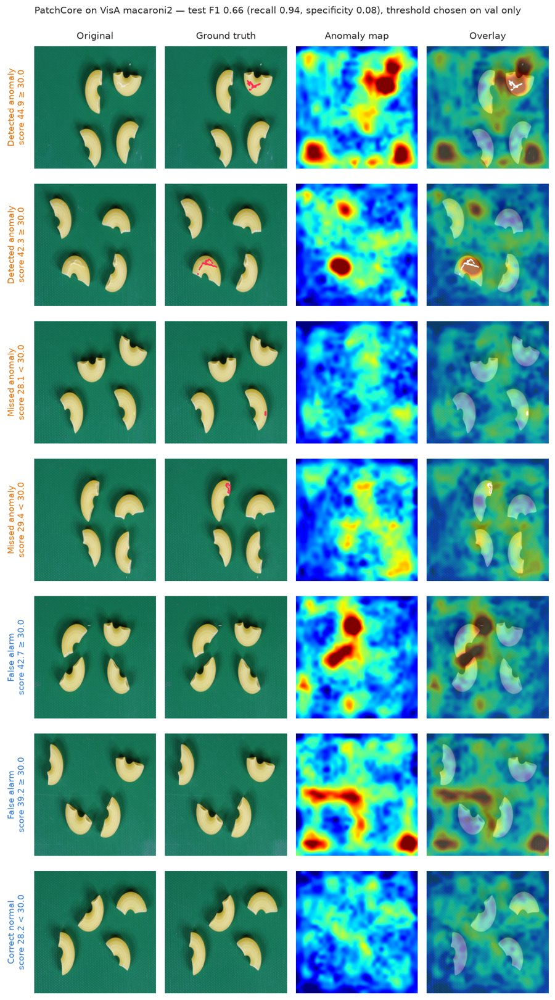
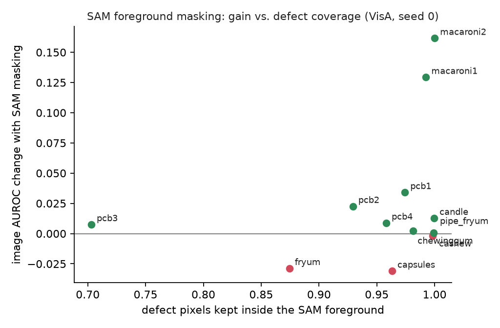

# patchcore-visa

PatchCore anomaly detection on the public [VisA](https://github.com/amazon-science/spot-diff) dataset, evaluated with a protocol designed to avoid optimistic results, plus an ablation of SAM foreground masking.

**Live demo:** [vision.lizheng.cc](https://vision.lizheng.cc/) (English / 日本語). Run the model on test images or your own upload, see each model's held-out score distribution, and try EfficientSAM masking. Source in [`visual-anomaly-lab/`](visual-anomaly-lab/).

## Why this project

I previously built a segmentation + PatchCore inspection pipeline on proprietary manufacturing data. Re-examining that work showed two common evaluation mistakes: random image-level splits that leak lots and devices across train and test, and decision thresholds tuned on the test set. This repository rebuilds the evaluation on open data, from scratch, with those mistakes designed out, and tests whether SAM foreground masking actually helps.

## Evaluation protocol

- **Train** on the official normal-only train split.
- **Split the official test set** per category and per label into `val` and `test` (seeded, see `src/iad/splits.py`).
- **Select the threshold on `val` only** (max F1 or Youden J), then apply it once to `test`.
- **Report** image AUROC on the full official test set (threshold-free, comparable with papers), plus thresholded recall, precision, specificity, and F1 on `test`.
- Label `1` always means anomalous. Metrics name the class explicitly (`anomaly_recall`, `normal_specificity`).

## Results

Setting: anomalib 2.7 PatchCore (Wide ResNet-50, layer2+3, 256×256 resize without center crop, coreset 10%), full train sets, **one seed (0)**, one RTX 4090. Numbers from a single seed; differences of about ±0.02 should not be over-read.

### Summary (mean over 12 categories)

| Metric | Value |
|---|---|
| Image AUROC (official test) | **0.902** |
| Pixel AUROC | **0.981** |
| Test F1, threshold = max F1 on val | 0.856 (recall 0.92, specificity 0.70) |
| Test F1, threshold = Youden J on val | 0.812 (recall 0.77, specificity 0.89) |
| Image AUROC with SAM post-hoc masking | 0.905 → **0.931** |
| Inference per image | GPU 7–15 ms; CPU (4 threads) 1.1–2.2 s |

### Per category

| Category | Image AUROC | Pixel AUROC | Test F1 / specificity (max-F1 threshold) | Test F1 / specificity (Youden) | AUROC without → with SAM mask | Defect pixels kept by mask |
|---|---|---|---|---|---|---|
| candle | 0.972 | 0.992 | 0.889 / 0.900 | 0.889 / 0.900 | 0.974 → 0.987 | 1.00 |
| capsules | 0.727 | 0.983 | 0.781 / 0.067 | 0.571 / 1.000 | 0.746 → 0.715 | 0.96 |
| cashew | 0.964 | 0.991 | 0.928 / 0.920 | 0.891 / 0.960 | 0.967 → 0.965 | 1.00 |
| chewinggum | 0.994 | 0.990 | 0.970 / 0.960 | 0.947 / 1.000 | 0.992 → 0.995 | 0.98 |
| fryum | 0.952 | 0.947 | 0.911 / 0.800 | 0.901 / 1.000 | 0.955 → 0.926 | 0.87 |
| macaroni1 | 0.808 | 0.965 | 0.717 / 0.460 | 0.585 / 0.840 | 0.812 → 0.942 | 0.99 |
| macaroni2 | 0.644 | 0.966 | 0.657 / 0.080 | 0.547 / 0.620 | 0.641 → 0.803 | 1.00 |
| pcb1 | 0.934 | 0.996 | 0.865 / 0.820 | 0.865 / 0.820 | 0.935 → 0.969 | 0.97 |
| pcb2 | 0.927 | 0.982 | 0.826 / 0.720 | 0.808 / 0.820 | 0.927 → 0.949 | 0.93 |
| pcb3 | 0.925 | 0.981 | 0.815 / 0.725 | 0.832 / 0.824 | 0.927 → 0.934 | 0.70 |
| pcb4 | 0.987 | 0.984 | 0.942 / 0.902 | 0.942 / 0.902 | 0.987 → 0.996 | 0.96 |
| pipe_fryum | 0.994 | 0.992 | 0.969 / 1.000 | 0.969 / 1.000 | 0.994 → 0.995 | 1.00 |

The SAM columns compare image scores taken as the maximum of the anomaly map, with and without the SAM foreground applied, so both use the same scoring rule. Full table: [`docs/results/e0_e1a_seed0.csv`](docs/results/e0_e1a_seed0.csv); per-image SAM mask QA: [`docs/results/sam_mask_qa.csv`](docs/results/sam_mask_qa.csv).

### Findings

**1. Single-object categories are near ceiling; multi-instance categories are the weak spot.** Candle, chewinggum, pcb4 and pipe_fryum reach 0.97–0.99 image AUROC. Capsules (0.73), macaroni2 (0.64) and macaroni1 (0.81) are much lower, yet their pixel AUROC stays at 0.97–0.98: defects are localized, but the image score is dominated by high-scoring normal regions.

**2. Most macaroni false alarms come from the background, and SAM masking removes them.** The textured green mat and shadowed corners in macaroni2 produce hot spots outside the pasta (rows 5–6 below). Scoring only inside the SAM foreground raised image AUROC by +0.16 (macaroni2) and +0.13 (macaroni1); the 12-category mean went from 0.905 to 0.931.



**3. Masking is not free, and defect coverage alone does not predict the outcome.** Fryum (−0.03) and capsules (−0.03) got worse: SAM cut off parts of fryum defects (87% of defect pixels kept) and is unstable on touching capsules. Pcb3 kept only 70% of defect pixels yet did not degrade. The practical rule: use masking where false alarms come from the background, and check mask QA (defect coverage) before shipping it.



**4. The threshold rule matters as much as the model on hard categories.** Selecting the threshold by max F1 on val collapsed for capsules and macaroni2 (specificity 0.07–0.08): with more anomalies than normals in val, labelling everything anomalous already maximizes F1. Youden J avoids the collapse (mean specificity 0.70 → 0.89) at the cost of recall. Both are reported; neither uses test data.

**5. Missed anomalies are mostly tiny defects; candle false alarms are background spots.** In [`docs/figures/examples_candle.jpg`](docs/figures/examples_candle.jpg), the two false alarms peak in the image corner and on a speck on the tray, not on a candle. At 256 px input, defects a few pixels wide almost vanish, which is why the missed candle defects are small dots.

### Not run (planned in `experiments/`)

Seeds 1–2 (variance), input-level SAM masking (E1b), ResNet-18 backbone (E2), coreset ratio (E3), and 512 px resolution (E4) are scripted but were not run for this report.

## Reproduce

```sh
python -m venv .venv && .venv/bin/pip install -e . anomalib transformers
scripts/download_visa.sh                       # ~1.8 GB, CC BY 4.0
.venv/bin/python scripts/make_splits.py --seed 0
.venv/bin/python -m unittest discover -s tests
bash experiments/run_all.sh E0                 # baseline; see experiments/README.md for all phases
.venv/bin/python scripts/report.py results     # tables and figures in docs/
```

PatchCore's memory bank for a 900-image category is about 5.7 GB before coreset sampling, so full runs need a GPU machine (this report: RTX 4090, about 1.5 hours for E0 seed 0 plus SAM masking).

## Roadmap

- [x] Leakage-free split and evaluation protocol with tests
- [x] anomalib PatchCore baseline on all 12 VisA categories (seed 0)
- [x] SAM foreground masks with defect-coverage QA; post-hoc masking ablation
- [x] Per-image heatmap figures and score distributions
- [ ] Remaining ablations: seeds, input-level masking, backbone, coreset ratio, resolution
- [ ] PatchCore reimplementation: Wide ResNet-50 features, greedy coreset, FAISS kNN, heatmaps
- [ ] Pixel-level PRO metric
- [x] Demo: upload an image, get a score and heatmap, compare with SAM masking ([vision.lizheng.cc](https://vision.lizheng.cc/))

## Data and license

VisA is released by Amazon under CC BY 4.0. The dataset is not redistributed in this repository. No proprietary data, code, or weights are used.
